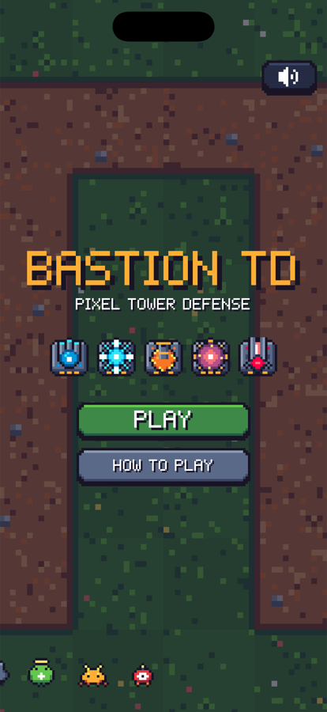
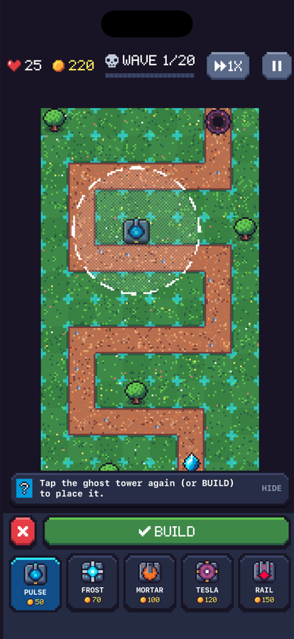
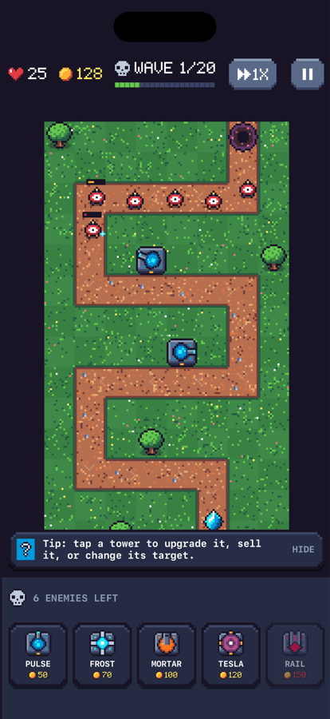
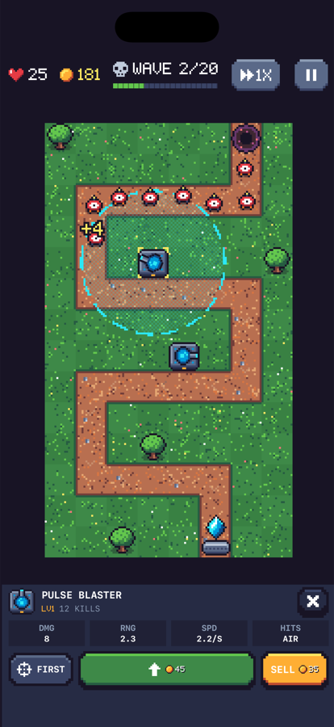

# Bastion TD

A pixel-art hero tower defense game for iPhone, written in Swift with SwiftUI (menus, HUD, overlays)
and SpriteKit (the battlefield). Every sprite, the bitmap font and all chiptune sound effects are
generated in code, so the project has no external art or audio assets apart from the app icon.

| Title | Placing a hero | Wave in progress | Hero panel |
|---|---|---|---|
|  |  |  |  |

(The screenshots predate the hero rename; the towers now carry hero names and two upgrade paths.)

## How to play

Villains march along a winding dirt path toward your crystal. Recruit heroes on the grass beside
the path; they attack automatically. Defeated villains drop gold, which you spend on more heroes
and upgrades. Each villain that reaches the crystal costs lives. Survive all 20 waves to win, and
keep going in Endless mode if you like.

- **Recruit**: pick a hero in the build panel, tap a highlighted tile to preview its range, then tap
  the ghost again (or press **BUILD**).
- **Upgrade**: tap a hero. Each hero has **two upgrade paths with four tiers**. Only one path can go
  past tier 2, as in Bloons TD. Tier 3 grants an active **power**; tier 4 empowers it.
- **Powers**: trigger them from the hero panel or the quick-cast buttons next to *Start Wave*. Each has
  a cooldown.
- **Research Lab**: every match (win or lose) earns **Research Points**. Spend them between matches
  to unlock tiers 2 to 4 for each path. Tier 1 is always available.
- **Medals**: twelve achievements that pay out Research Points.
- **Maps**: Circuit (Easy) → Switchback (Normal) → Overload (Hard). Each unlocks when you beat the
  previous one. Stars depend on lives left; Endless records are saved per map.
- **Controls**: 1×/2×/3× speed, pause menu (sound and haptics toggles, restart, how to play), and
  call the next wave early for bonus gold.

### Heroes

| Hero | Archetype | Attack | Path 1 → power | Path 2 → power |
|---|---|---|---|---|
| Blitz | Speedster | Rapid homing bolts | Velocity → **Hyperdrive** (attack-speed frenzy) | Impact → **Sonic Boom** (knockback blast) |
| Glacia | Ice hero | Slowing aura pulse | Permafrost → **Flash Freeze** | Hailstorm → **Blizzard** (damage/slow field) |
| Quake | Strongman | Lobbed boulders, splash, ground only | Seismic → **Earthshatter** (stun slam) | Fury → **Rampage** |
| Stormbringer | Thunder hero | Chain lightning | Tempest → **Thunderstrike** (8–16 sky bolts) | Skyhammer → **Skyhammer** (one colossal bolt) |
| Vanguard | Armored genius | Piercing beam, ignores armor, sees cloaked foes | Repulsor → **Overload Beam** | Arsenal → **Missile Swarm** |

### Villains

Drone, Skitter (fast), Bulwark (armored), Mender (heals), Wisp (flies), Splitter (splits into Shards),
Berserker (faster when hurt), Phantom (cloaked: needs detection), Hexer (shields allies),
**Titan** (boss, wave 10) and the **Overlord** (final boss: EMP that shuts heroes down).

## Requirements

- Xcode 26 or newer (built and tested with Xcode 27.1, iOS 27 simulator)
- iOS 17.0+ deployment target, iPhone (portrait and landscape)
- No package dependencies and no code generation step

## Open and run

1. Open `TowerDefense.xcodeproj` in Xcode.
2. Choose the **BastionTD** scheme and an iPhone simulator.
3. Press **Run** (⌘R).

To run on a physical iPhone, select your team under *Signing & Capabilities* and change the bundle
identifier (`com.example.BastionTD`) to one you own.

From the command line:

```bash
xcodebuild -project TowerDefense.xcodeproj -scheme BastionTD -destination 'platform=iOS Simulator,name=iPhone 17' build
```

### Debug launch arguments

Debug builds accept these arguments (set them in the scheme's *Run → Arguments*, or pass them to
`xcrun simctl launch`). They make simulator checks quicker and do nothing in Release builds.

| Argument | Effect |
|---|---|
| `-landscape` | Rotates the app to landscape at launch |
| `-unlockAll` | Unlocks all research and tops up Research Points |
| `-richStart` | Adds 5,000 starting gold to each match |

## Project structure

The project uses Xcode's folder-synchronized groups, so any file added under `TowerDefense/` is
picked up automatically.

```
TowerDefense/
├── App/            App entry point and RootView (navigation between menus, game and onboarding)
├── Models/         Pure data: maps, heroes and upgrade paths (HeroCatalog), villains and their
│                   abilities, waves, research, medals, saved progress
├── Engine/         The simulation (no UIKit/SpriteKit): GameEngine, entities, events, path geometry
├── Session/        GameSession: drives the engine each frame and publishes state to SwiftUI
├── Scene/          SpriteKit rendering: GameScene, nodes, effects, board layout
│   └── PixelArt/   Palette, software pixel canvas, 5x7 bitmap font, sprite maps, texture factory
├── Audio/          Offline chiptune synthesizer, AVAudioEngine mixer, haptics
├── UI/             SwiftUI screens: start/map select, game HUD and panels, hero panel,
│                   Research Lab, medals, pause/game over, onboarding, pixel UI kit
└── Assets.xcassets App icon (generated by Tools/make_app_icon.swift) and accent color
Tools/
├── BalanceSim/     Headless simulation with an AI player for tuning numbers
├── run_balance_sim.sh
└── make_app_icon.swift
docs/screenshots/   README images
```

### How the pieces fit

- `GameEngine` runs the whole game in tiles and seconds with a fixed 60 Hz timestep and reports what
  happened as `GameEvent`s. It is deterministic (seeded RNG) and testable without a device.
- `GameScene` asks `GameSession` to advance the engine every frame, mirrors entities into sprite nodes,
  and turns events into effects and sound. Touches become session commands.
- SwiftUI views observe `GameSession` (`@Observable`); it only republishes values that changed.
- The battlefield is drawn at 16 art pixels per tile and scaled by a whole number of device pixels,
  so the pixel art stays crisp on every iPhone. In portrait the board is rotated 90°, so villains
  enter from the top.

### Adding content

- **A villain**: add a case to `EnemyKind` (stats, traits such as `isCamo`, `abilities` made from
  `VillainAbility` building blocks), draw two frames in `SpriteMaps.enemyFrames`, give it a color in
  `Pal.enemy`, and use it in `WaveLibrary`.
- **A hero upgrade or power**: edit the paths in `HeroCatalog`. Each tier applies a closure to
  `TowerStats` and may attach a `PowerDefinition` built from the `PowerEffect` building blocks (burst,
  frenzy, strikes, field, missiles).
- **A map**: add a `MapDefinition` with axis-aligned waypoints and obstacles to `MapDefinition.all`.

## Balancing

`Tools/run_balance_sim.sh` compiles the Models and Engine for macOS and has a greedy AI play every map
with a fresh account and with full research, plus an Endless run:

```bash
./Tools/run_balance_sim.sh
```

Current targets: a fresh account can win Easy and Normal; full research makes those runs cleaner;
Hard is a stretch goal; a fully upgraded team reaches roughly wave 50 in Endless.

## Assets

None to install. The app icon was generated with:

```bash
swift Tools/make_app_icon.swift TowerDefense/Assets.xcassets/AppIcon.appiconset/AppIcon.png
```
